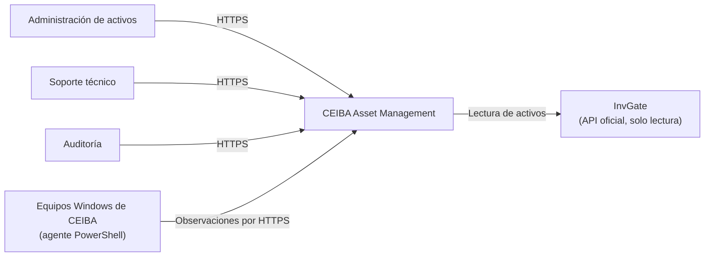
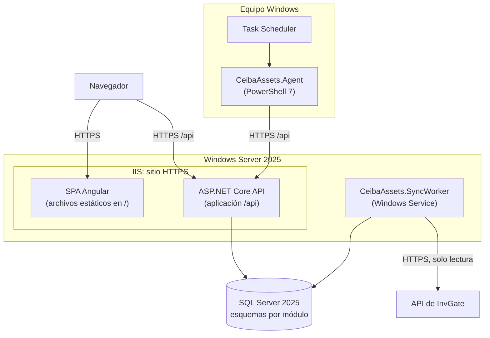
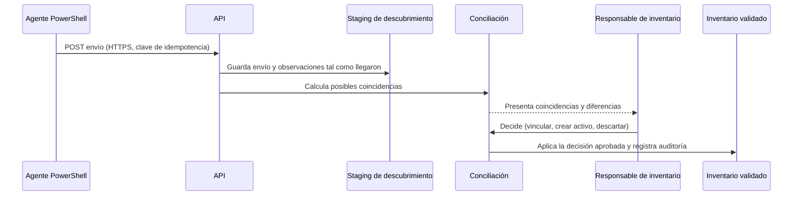
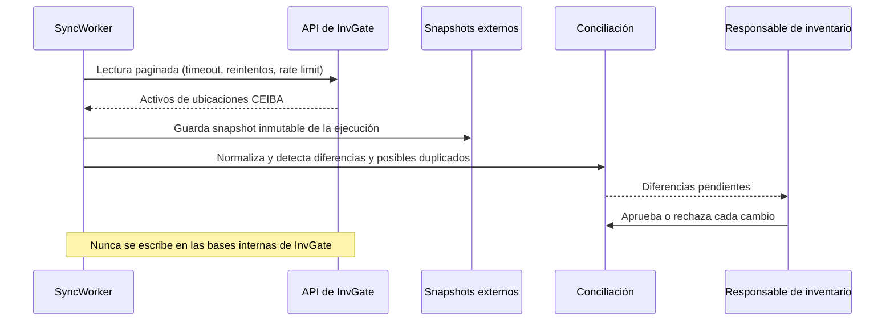

# Diagramas de arquitectura

Los diagramas usan Mermaid y GitHub los muestra directamente. Los elementos de fases futuras
representan el diseño objetivo.

## Contexto

## Contenedores

## Flujo de descubrimiento (Fase 7 y Fase 8)

## Flujo de sincronización con InvGate (Fase 9)

